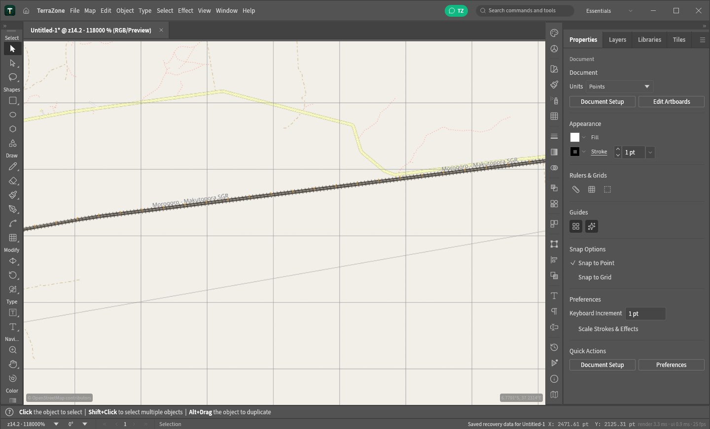
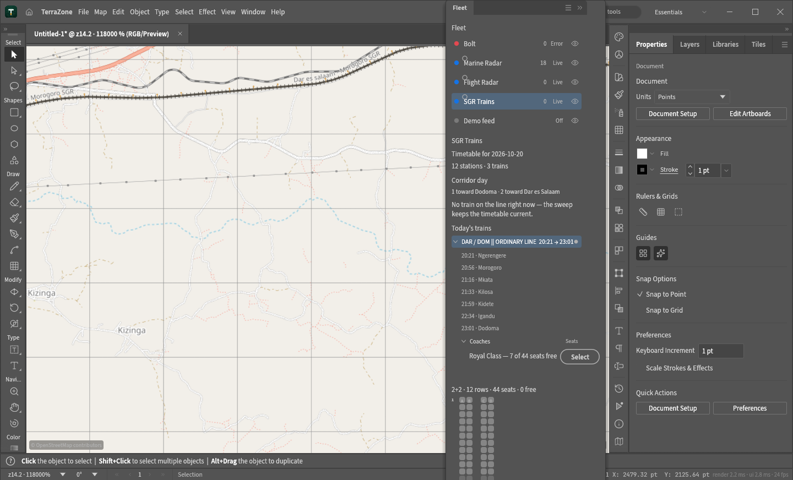
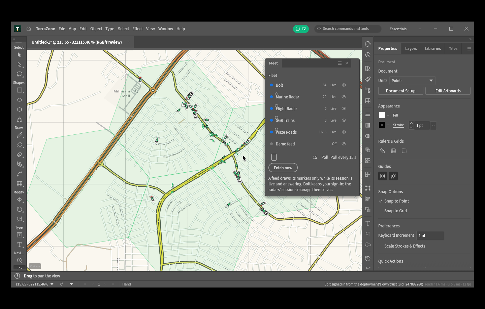
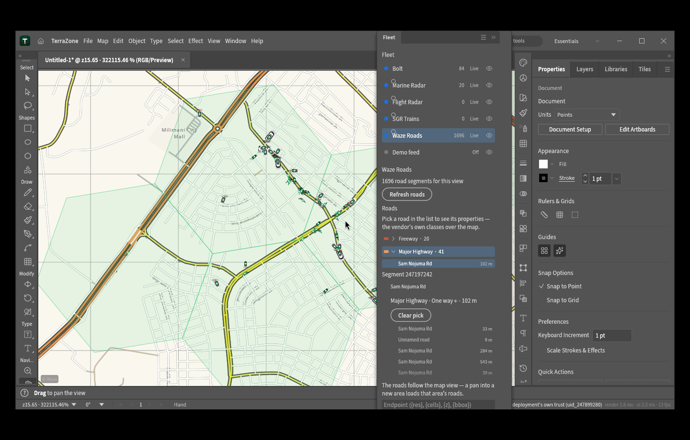

<h1 align="center">TerraZone</h1>

<p align="center"><em>An open-source map illustration editor: draw zones, paths and labels on the world.</em></p>

TerraZone is an independent open-source project: an original Rust-native desktop application where
**the document is a map**. The canvas is the
Web Mercator world (EPSG:3857) with a live tile basemap — OpenStreetMap, CARTO, Esri satellite,
OpenTopoMap or any XYZ source you add — and on top of it you draw with a full Illustrator-style
tool set: pen paths, shapes, type, selection, transforms, layers, appearance, swatches, symbols.

A TerraZone document *is* a Mercator world square (4096 × 4096 pt; one point is one tile pixel of
zoom 4, y pointing south). Every vector object lives in world coordinates, so a zone you draw over
Amsterdam stays over Amsterdam, imports land where their longitude/latitude says, and exports back
out as GeoJSON in WGS84.

TerraZone lives in this repository; its community hub is
[terrazon.app/community](https://terrazon.app/community). Code and assets are
MIT OR Apache-2.0 (NOTICE).

## The map

- **Tile basemap under the art** (`crates/map` holds the math; `crates/ui-egui/src/tiles.rs`
  fetches, decodes, caches and draws): OSM, Light/Dark (CARTO), Satellite (Esri World Imagery) and
  Topographic (OpenTopoMap) built in; Map ▸ Tile Sources… adds any XYZ template (`{z}/{x}/{y}`,
  optional `{s}` subdomains) with its own attribution, which the canvas always shows.
- **Web Mercator throughout** (`terrazon_map::lonlat_to_doc` / `doc_to_lonlat`): the status bar
  reads the pointer's latitude/longitude; imports and exports go through the same projection.
- **Zoom like a map app**: the whole world fitted in the window down to street level (tile zoom 19),
  with the editor's zoom stops extended to reach it.
- Tiles render on screen only; exports contain your vector art (zones, labels), not the basemap.

## The fleet

The document is also a live operations view. The Fleet feeds poll the vendors themselves and
register everything they draw in the Layers panel — the **Fleet group is the events system**
(one locked row per artifact: Bolt Vehicles + H3 Cells, Marine Vessels, Flight Aircraft, the
SGR's Rail Atlas + Stations + Trains, the Waze Roads, each with its own eye), while the
**Map group is the XYZ tile view** — the two systems read independently, and an eye gates
exactly its artifact.

- **Bolt** — vehicles as bearing-rotated pins over a ground shadow with a heading needle;
  signs in with the deployment's own trust pair (or your phone number + 4-digit code).
- **Marine Traffic** — the vessels in view, managing its own cookie session.
- **Flight Radar** — the aircraft in the current view's share.
- **Waze roads** — the vendor's own road network over the vendor's own basemap (a built-in
  tile source): the anonymous Features read the editor's web client makes for its view,
  drawn in the editor's palette (freeways brick red over the pack, collectors yellow and
  orange, rail and trails dashed), and the Fleet panel lays the view's roads out as a tree —
  type groups open into named segments, the picked segment opens into its properties (the
  vendor's class, the direction bits, the length, the speeds, the level, toll and closure
  flags), and the map rides the pick a white halo. The roads follow the view: a pan into a
  new area loads that area's roads.
- **SGR trains** — the active trains only: a train rides its own times along the standard
  gauge line while it is on it, and the map draws nothing else — departures still waiting
  and finished runs live in the panel's day tree. The atlas names the railways, so the view
  is the SGR's alone: the old TAZARA (1067 mm) and the meter-gauge Central Line are
  detected in the data and stay off the canvas. The line itself draws like a railway —
  ballast bed, twin rails, sleepers at street zooms — and the electric corridor carries its
  catenary posts and wire (2D) and raises them in 3D, where the running trains are four-car
  sets in the TRC livery.

|  |
|---|
| Live fleet — Bolt pins over Dar es Salaam, Marine vessels in the bay, the SGR rail highlight
  running to the Central Railway Station. |

View ▸ **Map Grid Lines** draws the degree graticule (strengthened so it reads on pale and busy
basemaps alike), and the SGR panel keeps the vendor's published day — running trains riding the
rail, waiting departures fanned at their origins:

|  |
|---|
| The Map Grid Lines graticule over a pale basemap. |

|  |
|---|
| The SGR's whole day — running trains + waiting departures dimmed at their origin stations. |

|  |
|---|
| 0.26.0 — the SGR drawn as a railway: ballast bed, twin rails, sleepers and the electric
  corridor's catenary, with the OSM name ("Morogoro - Makutopora SGR") reading along it. |

|  |
|---|
| 0.26.0 — the corridor day in the Fleet panel: the Dar ↔ Dodoma counts, a train's chain
  tree (every stop of the ride, the coaches under it, the vendor's own seat grid). |

|  |
|---|
| 0.27.0 — Dar es Salaam on Waze's own basemap with the Waze Roads layer over it: 1,696 of
  the vendor's segments in the editor's palette (the orange major, the yellow minors, the
  cased streets), the live Bolt cars riding them. |

|  |
|---|
| 0.27.0 — the roads as a tree in the Fleet panel: the vendor's type groups (Freeway · 20,
  Major Highway · 41), a picked segment with its properties (name, class, direction, length)
  and its siblings, the map riding the pick. |

|  |
|---|
| Fleet artifacts drawing while the basemap tiles load at z8. |

## The 3D environment

The `2D`/`3D` canvas switch opens the second canvas: the basemap's imagery draped flat on the
datum in perspective, the terrain's contour lines with their heights, the document's own drawing
draped as-is, the placed assets standing on the ground, and the fleet's live markers.

- **The endless grid** — the ground grid copies the EffectCraft viewer's: it un-projects the
  screen corners onto the datum, marches horizon rays out to a far clamp ring, adapts its
  1-2-5 step to the zoom (minor/major/super hierarchy, minor lines dropped under 4 px), clips
  every segment against the camera frustum and melts the far ends into the sky with a horizon
  haze — so the grid fills the viewport at every camera and never visibly ends.
- **Two camera modes** (the EffectCraft pair, switchable in the Camera 3D panel): **Orbit**,
  the drag-to-orbit arm with Shift-pan, wheel dolly and double-click recentre; and **Walk**,
  the first-person rig — W/A/S/D walks forward/left/back/right, Space-drag (or Alt-drag with a
  tool up) looks, Q/E sinks or lifts, Shift runs, the wheel raises or lowers. Switching hands
  the view over — the walk stands where the orbit stood, the orbit re-aims from where the walk
  ended — so the scene never jumps.

## Files

| Task | How |
|---|---|
| New map | Home ▸ a basemap card, or File ▸ New (the World Map preset; `file.new`) |
| Import | File ▸ Import… (or Map ▸ Import GeoJSON or SHP…) — the dialog is titled "Import Map Data — TerraZone, GeoJSON, SHP" |
| GeoJSON | `.geojson` / `.json` — RFC 7946, [lon, lat]; polygons import with EvenOdd rings (holes read back); `name`/`title` properties become the Layers panel names |
| Shapefile | `.shp` — points, multi-points, polylines and polygons (2D and Z/M); zones are named Zone 1… (rename them in Layers) |
| Save | `.terrazon` (the native map document: settings, map sources and all), or Save As GeoJSON / SVG / PDF / .ai |
| Export | Map ▸ Export as GeoJSON… — every path out as a feature, names as `name` properties |

Everything is a command (`map.setSource`, `map.showTiles`, `map.addSource`, `map.removeSource`,
`map.sources` — see `crates/engine/src/cmd/map.rs`), so the control channel and MCP drive the map
like any other feature: `{"id":1,"method":"engine.execute","params":{"command":"map.setSource",
"params":{"id":"carto-dark"}}}`.

## Building

Rust 1.95+ (edition 2024):

```sh
cargo build --release -p terrazon
# → target/release/terrazon
```

On small machines (2 cores, little disk) the same binary builds faster with
`CARGO_PROFILE_RELEASE_LTO=off CARGO_PROFILE_RELEASE_CODEGEN_UNITS=16` — the profile is already
wired for it. A GL (glow) build exists for machines where wgpu has no adapter:
`cargo build --release -p terrazon --no-default-features --features windows7`.

**Download a build:** every `v*` tag gets runnable **Windows x64** and **Linux x86_64**
archives attached to its GitHub Release by `.github/workflows/release-binaries.yml` —
unzip and run, no redist on Windows (static CRT), rustls TLS everywhere. The full installer
pipeline (macOS, MSI, AppImage, Flatpak, FreeBSD, web) lives in `release.yml` on the
`release` branch — see `docs/releasing.md`.

The web (WASM) build stays upstream-compatible (`apps/terrazon-web`, Trunk); it draws the map's
placeholder grid until tiles are fetched for it — the desktop binary fetches tiles itself over
HTTPS with a proper user agent.

## Developing

- `cargo xtask ci` — fmt, clippy, tests, asset attribution, brand scan, layering, wasm check.
- `cargo test -p terrazon-map` — the Mercator/tile math (world square, tile placement, view
  enumeration, URL templates, sources round-trip).
- `cargo test -p terrazon-engine --lib map:: fileio::` — the map commands and the GeoJSON/SHP
  importers.
- Architecture conventions live in `CLAUDE.md` / `AGENTS.md`; the crate graph in `xtask/src/layers.rs`.

## Credits

- [OpenStreetMap](https://www.openstreetmap.org) — map data and the standard tile style
  (© OpenStreetMap contributors, ODbL; attribution shown on the canvas).
- [CARTO](https://carto.com) Basemaps, [Esri](https://www.esri.com) World Imagery and
  [OpenTopoMap](https://opentopomap.org) — the other built-in tile sources, each attributed on the
  canvas when active.
- Lucide icons (ISC), Source Sans 3 / Source Serif 4 / Inter / JetBrains Mono (SIL OFL 1.1) — see
  `ASSETS.md` and `NOTICE`.

Tile sources are used under their terms; a custom source you add should be one you're allowed to
use, and its attribution line is yours to fill in honestly.
