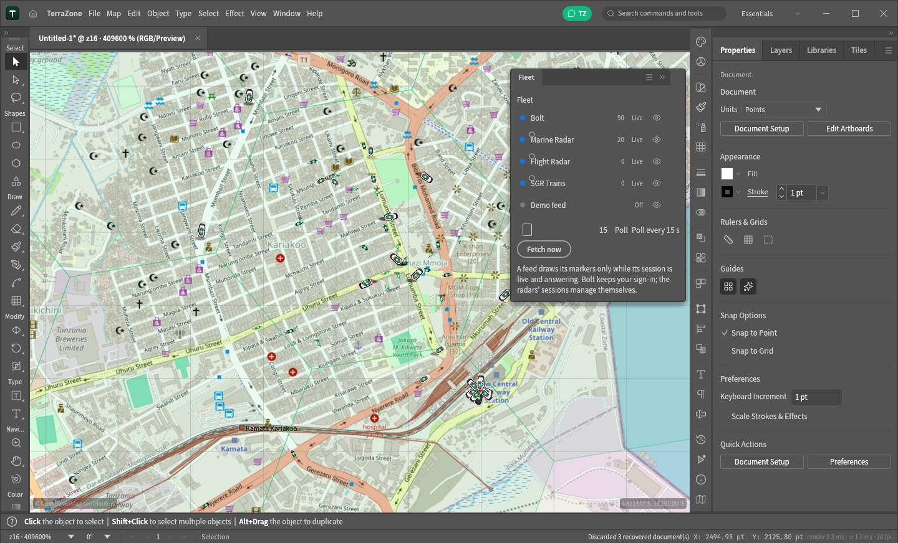
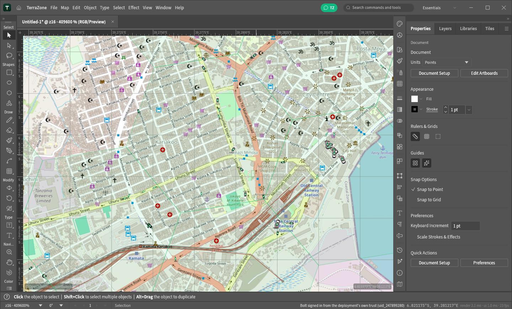
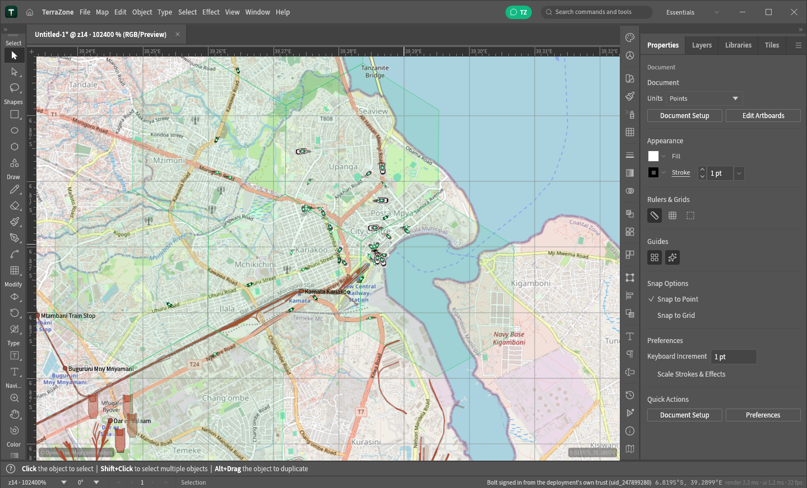
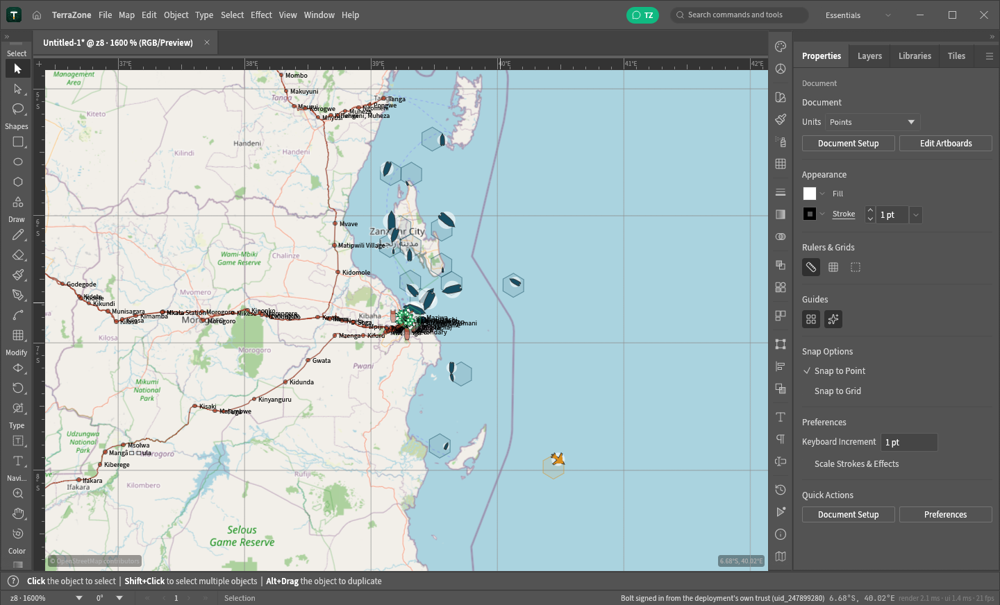

<h1 align="center">TerraZone</h1>

<p align="center"><em>An open-source map illustration editor: draw zones, paths and labels on the world.</em></p>

TerraZone is an independent open-source project: an original Rust-native desktop application where
**the document is a map**. The canvas is the
Web Mercator world (EPSG:3857) with a live tile basemap — OpenStreetMap, CARTO, Esri satellite,
OpenTopoMap or any XYZ source you add — and on top of it you draw with a full Illustrator-style
tool set: pen paths, shapes, type, selection, transforms, layers, appearance, swatches, symbols.

A TerraZone document *is* a Mercator world square (4096 × 4096 pt; one point is one tile pixel of
zoom 4, y pointing south). Every vector object lives in world coordinates, so a zone you draw over
Amsterdam stays over Amsterdam, imports land where their longitude/latitude says, and exports back
out as GeoJSON in WGS84.

TerraZone lives in this repository; its community hub is
[terrazon.app/community](https://terrazon.app/community). Code and assets are
MIT OR Apache-2.0 (NOTICE).

## The map

- **Tile basemap under the art** (`crates/map` holds the math; `crates/ui-egui/src/tiles.rs`
  fetches, decodes, caches and draws): OSM, Light/Dark (CARTO), Satellite (Esri World Imagery) and
  Topographic (OpenTopoMap) built in; Map ▸ Tile Sources… adds any XYZ template (`{z}/{x}/{y}`,
  optional `{s}` subdomains) with its own attribution, which the canvas always shows.
- **Web Mercator throughout** (`terrazon_map::lonlat_to_doc` / `doc_to_lonlat`): the status bar
  reads the pointer's latitude/longitude; imports and exports go through the same projection.
- **Zoom like a map app**: the whole world fitted in the window down to street level (tile zoom 19),
  with the editor's zoom stops extended to reach it.
- Tiles render on screen only; exports contain your vector art (zones, labels), not the basemap.

## The fleet

The document is also a live operations view. The Fleet feeds poll the vendors themselves and
register everything they draw in the Layers panel — the **Fleet group is the events system**
(one locked row per artifact: Bolt Vehicles + H3 Cells, Marine Vessels, Flight Aircraft, the
SGR's Rail Atlas + Stations + Trains, each with its own eye), while the **Map group is the
XYZ tile view** — the two systems read independently, and an eye gates exactly its artifact.

- **Bolt** — vehicles as bearing-rotated pins over a ground shadow with a heading needle;
  signs in with the deployment's own trust pair (or your phone number + 4-digit code).
- **Marine Traffic** — the vessels in view, managing its own cookie session.
- **Flight Radar** — the aircraft in the current view's share.
- **SGR trains** — the day's whole timetable drawn on the rail: running trains ride their
  segment, departures still waiting sit dimmed at their origin station, finished runs drop
  off while the panel's day list keeps them.

|  |
|---|
| Live fleet — Bolt pins over Dar es Salaam, Marine vessels in the bay, the SGR rail highlight
  running to the Central Railway Station. |

View ▸ **Map Grid Lines** draws the degree graticule (strengthened so it reads on pale and busy
basemaps alike), and the SGR panel keeps the vendor's published day — running trains riding the
rail, waiting departures fanned at their origins:

|  |
|---|
| The Map Grid Lines graticule over a pale basemap. |

|  |
|---|
| The SGR's whole day — running trains + waiting departures dimmed at their origin stations. |

|  |
|---|
| Fleet artifacts drawing while the basemap tiles load at z8. |

## Files

| Task | How |
|---|---|
| New map | Home ▸ a basemap card, or File ▸ New (the World Map preset; `file.new`) |
| Import | File ▸ Import… (or Map ▸ Import GeoJSON or SHP…) — the dialog is titled "Import Map Data — TerraZone, GeoJSON, SHP" |
| GeoJSON | `.geojson` / `.json` — RFC 7946, [lon, lat]; polygons import with EvenOdd rings (holes read back); `name`/`title` properties become the Layers panel names |
| Shapefile | `.shp` — points, multi-points, polylines and polygons (2D and Z/M); zones are named Zone 1… (rename them in Layers) |
| Save | `.terrazon` (the native map document: settings, map sources and all), or Save As GeoJSON / SVG / PDF / .ai |
| Export | Map ▸ Export as GeoJSON… — every path out as a feature, names as `name` properties |

Everything is a command (`map.setSource`, `map.showTiles`, `map.addSource`, `map.removeSource`,
`map.sources` — see `crates/engine/src/cmd/map.rs`), so the control channel and MCP drive the map
like any other feature: `{"id":1,"method":"engine.execute","params":{"command":"map.setSource",
"params":{"id":"carto-dark"}}}`.

## Building

Rust 1.95+ (edition 2024):

```sh
cargo build --release -p terrazon
# → target/release/terrazon
```

On small machines (2 cores, little disk) the same binary builds faster with
`CARGO_PROFILE_RELEASE_LTO=off CARGO_PROFILE_RELEASE_CODEGEN_UNITS=16` — the profile is already
wired for it. A GL (glow) build exists for machines where wgpu has no adapter:
`cargo build --release -p terrazon --no-default-features --features windows7`.

**Download a build:** every `v*` tag gets runnable **Windows x64** and **Linux x86_64**
archives attached to its GitHub Release by `.github/workflows/release-binaries.yml` —
unzip and run, no redist on Windows (static CRT), rustls TLS everywhere. The full installer
pipeline (macOS, MSI, AppImage, Flatpak, FreeBSD, web) lives in `release.yml` on the
`release` branch — see `docs/releasing.md`.

The web (WASM) build stays upstream-compatible (`apps/terrazon-web`, Trunk); it draws the map's
placeholder grid until tiles are fetched for it — the desktop binary fetches tiles itself over
HTTPS with a proper user agent.

## Developing

- `cargo xtask ci` — fmt, clippy, tests, asset attribution, brand scan, layering, wasm check.
- `cargo test -p terrazon-map` — the Mercator/tile math (world square, tile placement, view
  enumeration, URL templates, sources round-trip).
- `cargo test -p terrazon-engine --lib map:: fileio::` — the map commands and the GeoJSON/SHP
  importers.
- Architecture conventions live in `CLAUDE.md` / `AGENTS.md`; the crate graph in `xtask/src/layers.rs`.

## Credits

- [OpenStreetMap](https://www.openstreetmap.org) — map data and the standard tile style
  (© OpenStreetMap contributors, ODbL; attribution shown on the canvas).
- [CARTO](https://carto.com) Basemaps, [Esri](https://www.esri.com) World Imagery and
  [OpenTopoMap](https://opentopomap.org) — the other built-in tile sources, each attributed on the
  canvas when active.
- Lucide icons (ISC), Source Sans 3 / Source Serif 4 / Inter / JetBrains Mono (SIL OFL 1.1) — see
  `ASSETS.md` and `NOTICE`.

Tile sources are used under their terms; a custom source you add should be one you're allowed to
use, and its attribution line is yours to fill in honestly.
